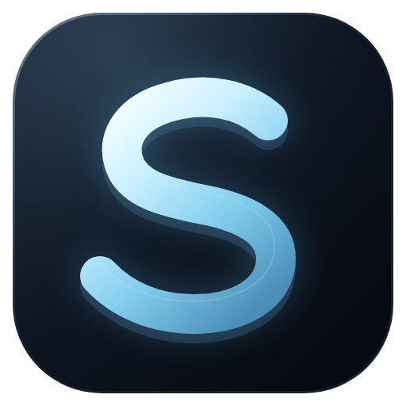
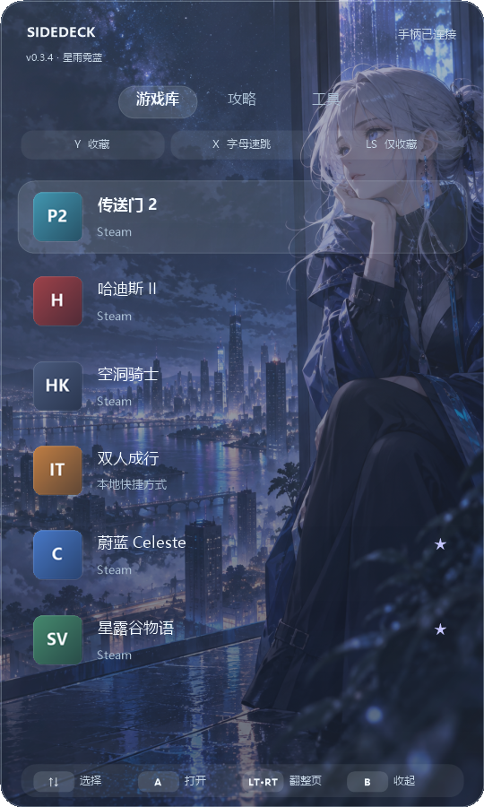
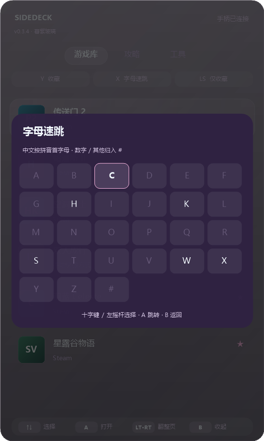
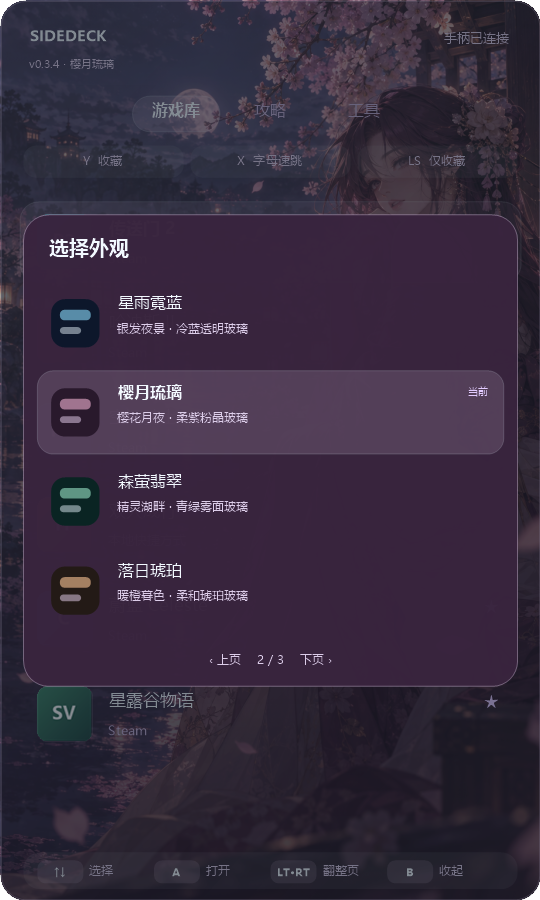

<p align="center">  
    
</p>

<h1 align="center">SideDeck</h1>

<p align="center">Windows 游戏侧边栏</p>

<p align="center">  
    
    
    
    
    
</p>

<p align="center">  
  <a href="https://github.com/ghost0hand/SideDeck/releases/latest">下载</a> ·  
  <a href="#操作">操作</a> ·  
  <a href="#构建">构建</a> ·  
  <a href="THEMES.md">主题格式</a> ·  
  <a href="https://github.com/ghost0hand/SideDeck/issues">反馈</a>  
</p>

<p align="center">  
    
    
    
</p>

本项目基于 Win32 / GDI+ 开发，无第三方 UI 框架或额外运行时依赖。安装后驻留系统托盘，按 **LB + RB** 或 **Ctrl + Space** 呼出、收起侧边栏。

面板打开时接管前台焦点，支持手柄、键盘和触屏操作，可在 Moonlight 串流设备上使用。

| 项目   | 支持情况                               |
| ---- | ---------------------------------- |
| 系统   | Windows 10 / 11 x64                |
| 手柄   | XInput 手柄，默认无需安装驱动                 |
| 触屏   | Moonlight 直接触控模式下支持滑动和点按           |
| 游戏来源 | Steam、Epic、开始菜单；手动添加 exe、快捷方式或 URL |

## 操作

| 功能        | 手柄               | 键盘                |
| --------- | ---------------- | ----------------- |
| 呼出 / 收起面板 | LB + RB；或长按 Back | Ctrl + Space      |
| 上下选择      | 十字键 ↑↓ / 左摇杆     | ↑↓                |
| 切换标签      | LB / RB          | ← / →             |
| 打开选中项     | A                | Enter             |
| 返回        | B                | Backspace         |
| 收起面板      | Start            | Esc               |
| 收藏 / 取消收藏 | Y                | F2                |
| 移除条目      | 长按 RS            | 长按 Delete         |
| 字母速跳      | X                | F3；也可直接按 A–Z      |
| 全部 / 仅收藏  | 按下左摇杆            | F4                |
| 整页翻动      | LT / RT          | PageUp / PageDown |

中文按拼音首字母归类，英文按 A–Z，数字与符号归入 `#`。呼出组合键可在 **工具页-呼出组合键** 修改。

长按 RS 或 Delete 约 0.8 秒进入移除确认。移除只影响侧栏条目，不删除游戏文件：手动条目从配置中删除；扫描条目写入 `removed`，避免重新扫描后恢复；重新添加同一文件可撤销移除。

## 主题与外观

主题包由 `theme.json` 和同目录的背景图（PNG / JPG）或 `wallpaper.mp4` 组成。通过 **工具页-导入主题包** 导入，或将主题文件夹放入 `themes/` 后刷新。字段说明见 [THEMES.md](THEMES.md)。

内置九套主题：四套纯色、五套插画(基于AI绘制)。

**工具页-玻璃效果** 提供背景模糊、背景可见、玻璃浓度、顶部光泽和面板圆角五项设置。参数以主题配置为基准，`1.0` 为默认值，修改后保存至 `config.json`。

界面按屏幕分辨率自动缩放，也可通过 **工具页-界面缩放** 手动调整。动态壁纸使用 Media Foundation 解码，解码失败时显示静态背景。

## 资源占用

以下为托盘闲置状态的本机一分钟采样，测试环境为 1080p、45 个条目；实际占用随条目数和主题变化。

| 项目   | 数值                      |
| ---- | ----------------------- |
| 工作集  | 84 MB，采样期间无明显增长         |
| 私有内存 | 58 MB                   |
| 句柄   | 742，采样期间无明显增长           |
| 面板打开 | 增加玻璃层与帧缓冲区；卡片缓存上限 24 MB |

## 手柄隔离

默认模式不安装驱动，面板通过接管前台焦点减少输入泄漏；持续读取后台手柄的游戏仍可能收到按键。

**工具页-手柄输入隔离** 使用 HidHide 与 ViGEmBus，需要单独安装驱动并完成设备验证。一次仅支持一只 XInput 手柄；SideDeck 安装过程不会安装驱动或重启系统。

## 构建

需要 Windows、PowerShell 7 和支持 C++17 的 MinGW-w64。将 `g++.exe` 加入 PATH，或通过 `SIDEDECK_CXX` 指定路径。

```powershell
./build.ps1                        # 发布版 → build/release/
./build.ps1 -Configuration Debug   # 调试版
./test.ps1                         # 回归测试
./tools/package.ps1                # 安装包，需 Inno Setup 6/7
./tools/package.ps1 -Offline       # 使用本地依赖构建安装包
```

`-Configuration` 另支持 `FocusTest`、`InputTest`、`PerfTest` 和 `VideoTest`。

修改 `docs/icon.svg` 后运行 `python tools/make-icon.py`，重新生成 `src/SideDeck.ico` 和 `docs/icon.png`。

## 已知限制

- 输入隔离一次仅支持一只 XInput 手柄。
- 渲染耗时随面板面积增加：本机 1080p 静态主题约 2 ms/帧，4K 动态壁纸约 15 ms/帧。

当前版本见 [VERSION](VERSION)，第三方组件与许可见 [THIRD\_PARTY\_NOTICES.md](THIRD_PARTY_NOTICES.md)。
